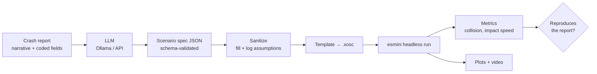

# crash2sim: Crash reports → LLM → OpenSCENARIO → esmini

UGA Engineering Capstone (Fall 2026), part of the Bosch-sponsored project *LLM-Assisted Scenario Generation and Simulation for Automated Driving Validation*.
**Two-week milestone demo, Nov 20, 2026.**

The pipeline takes a written crash report (narrative plus coded fields), uses an LLM to extract a small, typed **scenario spec**, renders that spec into an **OpenSCENARIO 1.2** file from a template, and runs it in **esmini**. It then checks whether the simulation reproduces the reported crash.



**Why a spec and not raw XML?** LLMs write invalid OpenSCENARIO easily. Here the LLM only fills about 15 typed fields, which are checked against a JSON Schema (`src/crash2sim/schema.py`). Templates (`templates/`) guarantee that the generated `.xosc` is valid and runnable. Every value the LLM had to guess is recorded in `assumptions`.

---

## Quick start

```bash
git clone <this repo> && cd crash2sim
python -m venv .venv && source .venv/bin/activate     # Windows: .venv\Scripts\activate
pip install -r requirements.txt
./scripts/setup_esmini.sh                              # or download esmini manually (see .env.example)
cp .env.example .env                                   # set ESMINI_BIN

# LLM (local, free): install Ollama from https://ollama.com, then
ollama pull llama3.1:8b

python run_pipeline.py --backend ollama --video        # LLM-generated scenarios
python run_pipeline.py --backend ground_truth --video  # hand-built reference scenarios
python run_pipeline.py --backend rules                 # no-LLM baseline
python make_summary.py                                 # comparison figures + outputs/SUMMARY.md
pytest -q
```

Other LLMs: `--model qwen2.5:7b`, or `--backend openai` with any OpenAI-compatible endpoint configured in `.env` (OpenAI, Groq, Together, a Hugging Face Inference Endpoint, vLLM).

Each report produces:

| Path | What it is |
|---|---|
| `outputs/<backend>/<report>/spec_raw.json` | raw LLM output |
| `outputs/<backend>/<report>/spec.json` | validated + sanitized spec |
| `scenarios/generated/<backend>/<report>.xosc` | OpenSCENARIO file (opens in esmini) |
| `outputs/<backend>/<report>/scenario.png` | top-down path, speed and distance over time |
| `outputs/<backend>/<report>/scenario.mp4` | esmini render (`--video`) |
| `outputs/<backend>/<report>/metrics.json` | collision, impact speeds, brake onset, min distance |
| `outputs/<backend>/summary.csv` | one row per report |

To watch a scenario interactively: `$ESMINI_BIN/esmini --window 60 60 1024 576 --osc scenarios/generated/ground_truth/CISS_A2.xosc`

---

## Scenarios in scope

| Template | Crash type | Road | Ego | Other vehicle |
|---|---|---|---|---|
| `rear_end` | Lead vehicle decelerating or stopped | `straight_500m` | follows and strikes | brakes at t = 2 s |
| `ltap_od` | Left turn across path, opposite direction | `fabriksgatan` (4-leg intersection) | goes straight | turns left, timed to the conflict point |

Ego braking is triggered by **hazard onset + reaction time**: the lead vehicle's brake event, a time to collision under 4 s, or the turning vehicle getting within 25–35 m. Lighting, weather and surface go into an `EnvironmentAction`, and road friction is scaled.

## Data

| Type | Source | Why |
|---|---|---|
| A: in-depth investigation | NHTSA **CISS** case viewer (crashviewer.nhtsa.dot.gov) | narrative, EDR speeds, scaled scene diagrams |
| B: ADS incident report | NHTSA **Standing General Order 2021-01** CSVs | real automated-vehicle crashes; narratives often redacted |

> ⚠️ **The 4 reports in `data/reports/` are illustrative placeholders** (`"synthetic": true`). They follow the structure of each source but are not real cases. Before the results are cited, swap in 2 real cases per type (same JSON shape) and update `data/ground_truth/` and `data/coverage.csv`.

### Finding 1: in-depth reports have enough detail; ADS reports mostly don't


- CISS-style reports cover about **80 %** of the scenario elements. Speeds come from EDR data, and the maneuvers and environment are stated.
- SGO reports cover **50–55 %**. Narratives are redacted, and there are no distances or timing.
- **No report type gives initial distances or positions.** The simulation always has to assume them.

### Finding 2: the simulation reproduces the crash when the timing assumptions are right


- With hand-built specs, 3 of 4 scenarios reproduce the reported crash. In **CISS_A2** the simulated impact speed is **32.6 km/h vs. 32 km/h** on the EDR.
- **SGO_B2** (fully redacted) does *not* reproduce: with the assumed values, the ADS stops in time. This is the key limitation: when the report lacks timing, the outcome depends on assumptions.
- The no-LLM keyword baseline gets 73–91 % of the fields right but reproduces only 1 of 4 crashes. It can't infer reaction behavior or headway. **That gap is what the LLM column has to close.**

## Repo layout

```
run_pipeline.py          CLI: report → spec → xosc → esmini → metrics/figures
make_summary.py          cross-backend figures + outputs/SUMMARY.md
src/crash2sim/
  schema.py              JSON Schema for the scenario spec + sanitize()
  extract.py             LLM backends (ollama, openai-compatible) + rules baseline; prompt
  build.py               spec → .xosc via templates
  simulate.py            esmini runner, dat→csv, video capture
  analyze.py             metrics, figures, scoring against ground truth
templates/               OpenSCENARIO templates with {{placeholders}}
sim_assets/              esmini road networks + catalogs (MPL-2.0, see LICENSE file there)
data/reports/            crash reports (JSON)
data/ground_truth/       hand-built specs (manual recreation)
data/coverage.csv        per-report data coverage assessment
tests/                   pytest
```

## Limitations and next steps

- Only 2 crash types. Next candidates: cut-in, pedestrian crossing, straight crossing path.
- No crash physics after impact (vehicles are stopped). Initial distances are always assumed.
- Videos use esmini's box models unless the esmini 3D model pack is installed; they render in daylight for readability.
- Next: real CISS/SGO cases, LLM model comparison (llama3.1 vs. qwen2.5 vs. an API model), automatic sweeps over assumed parameters (reaction time, gap) to show which assumptions decide the outcome, and CARLA export.

## Team

Nikhita Kunthu (lead), Joshua Oh: data processing · Marco Walther, Ansley Purdue: simulation & visualization
Supervisor: Dr. Yunli Shao (UGA) · Sponsor: Dr. Jian Tang (Bosch)

Simulator: [esmini](https://github.com/esmini/esmini) (MPL-2.0). Files under `sim_assets/` come from esmini's `resources/`.
